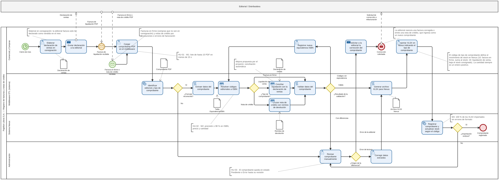

# Modelado BPMN — Registro de facturas de consignación y notas de crédito

**Archivos**
- `proceso-registro-comprobantes.bpmn`: modelo editable en BPMN 2.0 (se abre con bpmn.io, Camunda Modeler o cualquier herramienta compatible con BPMN 2.0).
- `proceso-registro-comprobantes.png` / `.svg`: el diagrama exportado.

## Contexto del proceso

La mayor parte del material que vende Papillon Libros S.A. llega **en consignación**: la editorial deja los libros en la librería y solo cobra lo vendido. Al cierre de cada mes, el encargado de Compras (Matías) declara a cada editorial lo vendido, y la editorial emite una **factura de liquidación** por esas unidades.

Además se procesan las **facturas en firme** (compras que no son en consignación) y las **notas de crédito** que las editoriales envían por devoluciones de material comprado en firme o por errores en facturas anteriores.

En Nexus todos estos comprobantes se cargan con el mismo formato y la cantidad siempre es un entero positivo. Lo que define el movimiento de stock es el **código de tipo de comprobante** que Compras indica al importar: por ejemplo, el código 10 (factura en firme) suma las cantidades al stock, y el código 19 (liquidación de venta) baja el stock consignado sin mover el stock real.

## Descripción del proceso

| | |
|---|---|
| **Proceso** | Registro de facturas de consignación y notas de crédito en Nexus |
| **Tipo** | Proceso de apoyo (administrativo): asegura que la información de compras y stock que usa el negocio sea correcta |
| **Dueño del proceso** | Departamento Comercial y Compras (Matías) |
| **Entradas** | Declaración mensual de ventas; factura de liquidación, factura en firme o nota de crédito en PDF; remitos de devolución |
| **Salida** | Comprobante registrado en Nexus con el movimiento de stock correspondiente |
| **Disparadores** | Cierre de mes (evento de inicio de tiempo) y llegada de una factura en firme o nota de crédito (evento de inicio de mensaje) |

### Pools y lanes

| Pool | Lane | Qué representa |
|---|---|---|
| Editorial / Distribuidora | — | Actor externo (pool colapsado): recibe la declaración y emite facturas de liquidación, facturas en firme y notas de crédito |
| Papillon Libros S.A. | Comercial y Compras | Declara las ventas, carga los comprobantes, mantiene las equivalencias ISBN, importa en Nexus indicando el tipo de comprobante y pide correcciones a la editorial |
| | Middleware ETL (sistema) | Comportamiento automatizado del software propuesto |
| | Sistema Nexus | Registra el comprobante y actualiza el stock según el código |
| | Administración | Control documental: revisa los comprobantes con diferencias |

### Flujo normal

1. Al **cierre de mes**, Compras **elabora la declaración de ventas en consignación** y la **envía a la editorial**.
2. El proceso espera la **factura de liquidación** (evento intermedio de recepción de mensaje). Una **factura en firme** o una **nota de crédito** inicia el proceso directamente.
3. Compras **carga el comprobante PDF** en el middleware.
4. El middleware **identifica la editorial y el tipo de comprobante**, **extrae los datos** y **resuelve los códigos editoriales a ISBN** con la tabla EquivalenciaISBN.
5. Según el tipo de comprobante:
   - la **liquidación de venta** se **concilia con la declaración de ventas** (*mejora propuesta por el proyecto*);
   - la **nota de crédito** se **cruza con los remitos de devolución** para detectar faltantes y sobrantes;
   - la **factura en firme** pasa directo a la validación.
6. El middleware **valida los datos** (precio × cantidad × (1 − descuento) contra el importe de cada renglón) y **genera el XLSX**.
7. Compras **importa el XLSX en Nexus indicando el tipo de comprobante**, y Nexus **registra el comprobante y actualiza el stock** según ese código. El proceso termina en *Comprobante registrado*.

### Compuertas de decisión (excepciones)

| Compuerta | Respuestas | Qué pasa |
|---|---|---|
| ¿Formato reconocido? | Sí / No | Si la editorial no tiene un formato soportado (o el PDF es escaneado), el comprobante pasa a revisión manual en Administración. |
| ¿Tipo de comprobante? | Liquidación de venta / Nota de crédito / Factura en firme | Cada tipo tiene su propio control previo a la validación. |
| ¿Resultado de la validación? | Válido / Códigos sin equivalencia / Con diferencias | Una sola compuerta con tres salidas, en lugar de compuertas anidadas. Los códigos sin equivalencia vuelven a Compras para registrar el ISBN y se reprocesan. Las diferencias (importes que no cierran, diferencias con la declaración o con los remitos de devolución) van a revisión manual. |
| ¿Origen de la diferencia? | Error de lectura / Error de la editorial | Si el error es de extracción, Administración corrige los datos y se regenera el XLSX. Si el error es de la editorial, Compras pide la corrección o refacturación (fin: *Corrección solicitada*). |
| ¿Importación exitosa? | Sí / No | Si Nexus rechaza el archivo, Administración revisa el comprobante. |

La editorial responde a una solicitud de corrección con una factura corregida o una nota de crédito, que vuelve a entrar al proceso como un comprobante nuevo.

### Convenciones aplicadas (apunte de la Unidad 5)

- Diagramado de izquierda a derecha, desde la esquina superior izquierda.
- Un pool por proceso. La editorial se modela como pool colapsado (actor externo). Entre pools solo hay líneas de mensaje (punteadas).
- Eventos de inicio de tiempo y de mensaje, y un evento intermedio de recepción de mensaje para la espera de la liquidación.
- Actividades nombradas con verbo en infinitivo y tipificadas (usuario, servicio, script, regla de negocio, envío).
- Compuertas exclusivas sin el marcador "X", con la pregunta debajo y todas las salidas etiquetadas. Antes de cada compuerta hay una tarea que evalúa la decisión.
- Data objects (declaración de ventas, comprobante PDF, tabla EquivalenciaISBN, remitos de devolución, archivo XLSX) unidos con líneas de asociación, y anotaciones que vinculan el diagrama con las Historias de Usuario, las metas y la regla de códigos de Nexus.

### Relación con el resto del TPI

| Elemento del diagrama | Historia de Usuario | Meta (Entrega 2) | Entidad (Entrega 3) |
|---|---|---|---|
| Cargar comprobante, generar XLSX, importar en Nexus | HU-01 | M1, M4 | Comprobante, DetalleComprobante |
| Resolver códigos a ISBN, registrar equivalencia | HU-02 | M2 | EquivalenciaISBN |
| Revisión manual y estados del comprobante | HU-03 | M2, M4 | Comprobante (`estado`, `tipo_comprobante`) |
